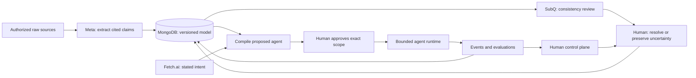

# Architecture · initial proposal

The current challenge-fit and Deputy CEO proposal is in FRAME.md. No integration in either document has been implemented.

This is the target architecture, not a diagram of deployed services.

## Stages

1. **Sources → claims.** Meta extracts candidate statements and evidence spans. Keep source text immutable and separate facts from interpretation. Validate structured output before storage.
2. **Claims → model.** MongoDB holds entities, relationships, claim lineage and model versions. Accepted and disputed claims are visible separately.
3. **Model → review.** SubQ evaluates deliberately scoped questions about consistency. The choice of model and whether to use decision scoring or generation is open. A review signal must include the compared evidence, method and limitations.
4. **Review → human decision.** Surface conflicting assertions; let the owner accept, reject, correct or leave unresolved. Record the decision and its scope.
5. **Model → agents.** Compile a proposed role from goals, accepted knowledge and explicit permissions. Require approval before activation. Fetch.ai is an optional external entry point into the same proposal process.
6. **Execution → learning.** Retain events, outcomes and revisions. A change to a model, policy or role is a proposal until the authorized decision process accepts it.

## What the human sees and controls

- Purpose: shared picture and memory; mission and boundaries.
- Rules: emergent culture and observed practices; explicit rules and authority.
- Resources: conservation and recovery; allocation and autonomy budgets.
- Relationships: commitments to people; voice, representation and participation.
- Progress: learning and evaluation; goals and delivery.

Owner confirmed this latest 5×2 framework on November 7. Keep it light: one Deputy CEO overview can cover all five. Trace each human decision through receipt, interpretation, application and observed behavior; acknowledgement is not compliance.

## First demo boundary

Use the synthetic spending-limit conflict. Show where each claim came from, why it is disputed, which limit the owner chooses, and the proposed agent scope that results. Later demonstrate a bounded action and an attempted out-of-scope action. Until those run, use the demo script as a plan, not as a product claim.
