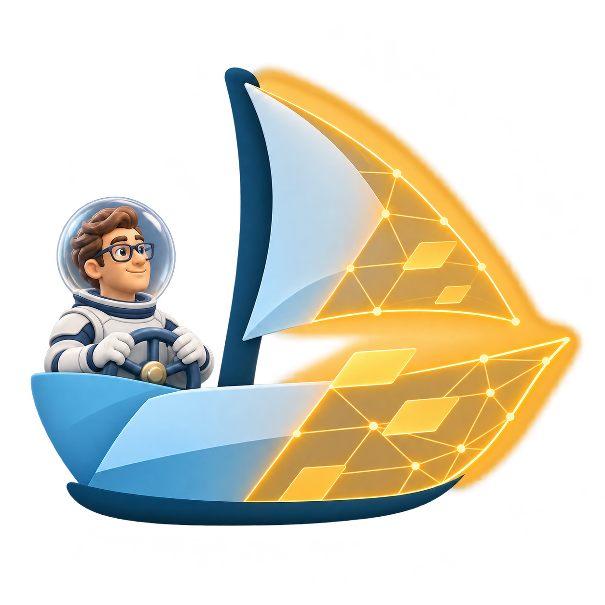

# Theseus visual identity · Firny family

November 7, 2026. **Selected by the owner: v8, the human in a spacesuit.** Landing pages and presentations must continue Firny's visual language. Earlier versions remain as process evidence.

## Current mark

**One ship. Half solid, half becoming. A human at the helm.**

The glacier-blue half continues Firny's visual language. The luminous amber half makes substantial reconstruction visible. A continuous navy keel holds the changing vessel together; a substantial dimensional human at the wheel makes the owner of direction explicit. His glasses, friendly face, softly modeled proportions and navy palette belong to Firny's character family.

Firny's existing landing follows the same material as it becomes data, knowledge and agents. Theseus extends that continuity into a vessel that rebuilds while underway. This is a visual metaphor, not proof of implemented governance.

## Assets

| File | Purpose | Status |
|---|---|---|
| [theseus-deputy-avatar-v1.png](theseus-deputy-avatar-v1.png) | Compact Deputy CEO avatar derived from v8; 1254 × 1254 RGBA, 1.61 MB | Prepared for owner review and later Agentverse upload; not uploaded |
| [theseus-logo-v8-spacesuit.png](theseus-logo-v8-spacesuit.png) | Full dimensional human in a light spacesuit with transparent helmet; 1254 × 1254 RGBA | Owner-selected current mark |
| [theseus-logo-v5.png](theseus-logo-v5.png) | Dimensional human in Firny's style, before spacesuit; 1254 × 1254 RGBA | Previous working selection, superseded by v8 |
| [theseus-logo-v7-avatar.png](theseus-logo-v7-avatar.png) | Portrait in a circular display at the helm; 1254 × 1254 RGBA | Rejected by owner |
| [theseus-logo-v6-face-only.png](theseus-logo-v6-face-only.png) | Detached face above the wheel; 1254 × 1254 RGBA | Rejected by owner: severed-head impression |
| [theseus-logo-v4.png](theseus-logo-v4.png) | Small flat human at the helm; 1254 × 1254 RGBA | Ship accepted; human rejected by owner |
| [theseus-logo-v3.png](theseus-logo-v3.png) | Same transformation before adding the human; 1254 × 1254 RGBA | Preceding iteration |
| [theseus-logo-v2.png](theseus-logo-v2.png) | Glacier vessel with one small replacement panel; 1254 × 1254 RGBA | Superseded exploration |
| [theseus-firny-hero-v2.png](theseus-firny-hero-v2.png) | Firny, human captain and ice vessel; 1536 × 1024 RGB | Narrative exploration; more detailed than the latest direction |
| [theseus-logo-v1.png](theseus-logo-v1.png) | Original jade ship | Rejected by owner; retained as history |

These are generated PNGs, not vector masters. All marks have verified transparency; the hero has a painted pale background. Original generation files were retained.

## Usage

Use v8 for project branding. Preserve the whole keel, amber reconstruction and human. Prefer a light glacier surface and inspect contrast on dark surfaces. Do not crop away the human or use the amber half as an operational warning.

For the Agentverse avatar, a separate compact derivative enlarges the human and helm while simplifying the ship: `theseus-deputy-avatar-v1.png`. Its file size is below the UI's 2 MB limit. It does not replace the v8 project mark. See [avatar provenance](GENERATION-DEPUTY-AVATAR-V1.md); actual profile crop remains to be previewed when the owner chooses to upload it.

Start at 128 px or larger and inspect at the actual display size. Favicon readability has not been validated; a dedicated small symbol and vector master remain separate work. Keep **Theseus Control Plane** as live text beside the mark.

## Palette and typography

| Role | Color |
|---|---|
| Navy structure and text | `#0B3A5E` |
| Glacier blue | `#3FA6E8` |
| Pale ice | `#DDE9F2` |
| Amber reconstruction | `#F5BF45` |
| Supporting teal relationships | `#40877C` |
| Snow background | `#F6F9FC` |
| White surface | `#FFFFFF` |
| Secondary text | `#5A7389` |

These are intended interface tokens, not guarantees for every raster pixel. Operational statuses still need text labels.

For landing pages and presentations, continue Firny's **Geist** sans-serif for primary type, **Instrument Serif** for restrained editorial accents, and **Geist Mono** for technical labels. Use spacious snow/white surfaces, navy headings, glacier-blue structure, sparse meaningful evidence connections and dimensional character art. Use amber to highlight the part being rebuilt; avoid turning the whole design into a neon space theme. `tokens.css` provides fallbacks but does not load font files. The existing reporting utility retains its own palette.

This packet has not been applied to the running app, Agentverse profile or another agent's presentation. The owner's acceptance selects v8 and the Firny visual family; it does not claim these assets have already been integrated or published.

## Provenance

The owner requested Firny continuity, then a much larger digital/yellow transformation and a human at the helm. After reviewing v4, he accepted the ship but rejected the small flat figure and requested a larger character in Firny's dimensional style. Inspected Firny's design record and references: `firny-site/public/firny-guide.png`, `firny-site/evidence/flow-graph-live.png`, and `firny-site/public/hero/firny-ocean-calm-v3.webp`.

Created with built-in image generation, without manual raster painting. Exact prompts and reference chain: [previous v5](GENERATION-V5.md), [rejected face-only v6](GENERATION-V6.md), [rejected avatar v7](GENERATION-V7.md), [spacesuit v8](GENERATION-V8.md). Original rejected prompt: [GENERATION-PROMPT.md](GENERATION-PROMPT.md).
